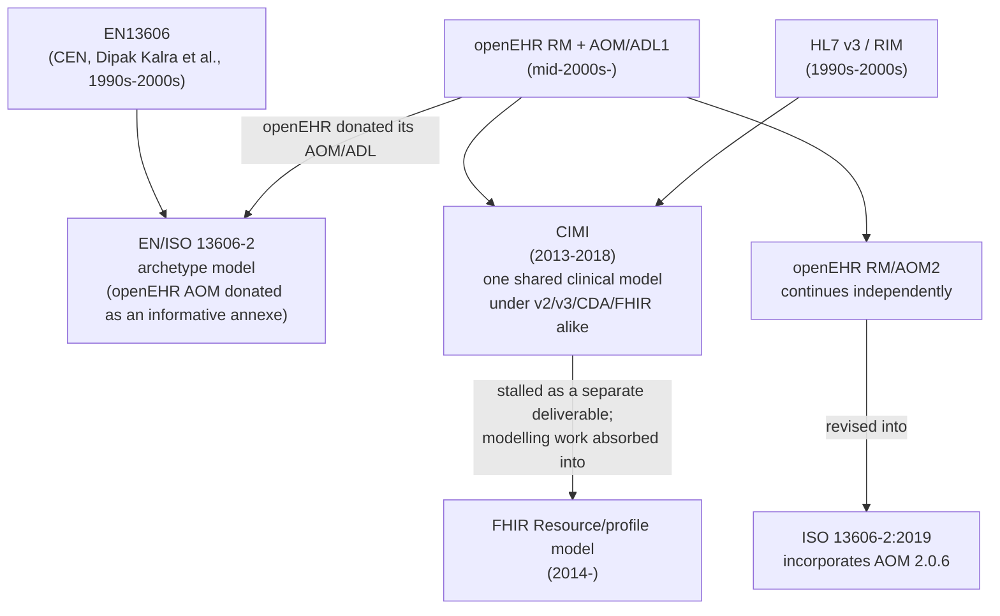

# Disambiguating the health-standards acronym soup

Health informatics has produced an unusual number of overlapping
standards bodies, standards, and projects whose names only make sense if you
already know the history. That is not a sign of rigour - it is a 25-year
symptom of nobody owning convergence. This page exists so that reading one
openEHR Discourse thread does not require a decade of institutional memory.

It is deliberately reference-grade: short definitions, who owns each thing,
how they relate, and a primary source for each. Where `anarchie` already has
a longer treatment of a topic, this page links out rather than repeating it.

!!! note "Where this came from"
    Prompted directly by a real [openEHR Discourse thread from
    2025](https://discourse.openehr.org/t/iso-13606-revision/6101), a good
    illustration of just how much institutional history (TC251, 13606, CEN,
    FHIR, CIMI, ADL2, JIC membership, OMOP) can be packed into one
    conversation among people who have been close to these standards for
    decades. Reading it cold needs more context than the thread itself
    supplies - this page is that context.

## Who governs what

Three kinds of organisation get conflated constantly: formal standards
bodies (can publish an ISO/CEN number, cannot force anyone to implement it),
a technical specification community (publishes a spec, no legal standing),
and a non-profit alliance (convenes people, publishes nothing normative
itself).

| Name | What it actually is | Publishes | Binding on anyone? |
|---|---|---|---|
| **ISO/TC 215** | The ISO technical committee for health informatics | ISO standards (13606, 13940, …) | No - ISO standards are voluntary unless a regulator or contract cites them |
| **CEN/TC 251** | The European standards committee for health informatics | EN (European Norm) standards, often adopted in parallel with ISO/TC 215's | No, with the same caveat |
| **HL7** (and HL7 Europe) | An international standards-development organisation | HL7v2, HL7v3/CDA, **FHIR** | No, until a jurisdiction mandates it |
| **openEHR Foundation** | A non-profit that stewards the openEHR specifications | The openEHR RM, AOM/ADL, AQL, ITS-REST specs | No, same caveat |
| **JIC** (Joint Initiative Council) | A coordination body between the above (ISO, CEN, HL7, openEHR, IHE, GS1, SNOMED International, DICOM and others) | Nothing itself - it coordinates who works on what, to reduce duplicate effort | No |
| **ESHIA** | A Brussels AISBL (non-profit), founded Sept 2025 by 18 partners including CEN/TC 251, HL7 Europe, IHE-Europe | Nothing normative - it hosts the EEHRxF "Standards & Policy Hub" and helps adoption | No |
| **European Commission / EHDS** | An EU institution and its regulation | A **binding EU Regulation** (in force Mar 2025) | **Yes** - the only entity on this table that can actually force anything |

The one-line version: everything above the EHDS row is **voluntary technical
work**. EHDS is **law**. A standard only becomes practically unavoidable when
a regulation like EHDS points at it - which is exactly why so much of the
Discourse thread is people trying to work out whether ISO 13606 is still
relevant now that EHDS exists and points mostly at FHIR instead.

openEHR became a JIC member relatively recently, which is part of why some of
these threads read as "wait, are we even talking to each other?" - the
coordination body itself is newer than most of the standards it coordinates.

## The reference-model family tree

These are the actual *information models* - the thing that says what a
clinical record looks like structurally. This is where openEHR, 13606, CIMI,
RIM, and FHIR actually relate to each other, as opposed to who's in which
committee.

- **openEHR's Reference Model (RM)** and **Archetype Object Model
  (AOM)/ADL** are openEHR's own, developed from the mid-2000s. ADL2/AOM2 is
  the current generation; `anarchie` reads ADL 1.4-era OPT XML and lowers it
  into a native form - see
  [specs/serialisation-formats.md](https://github.com/pacharanero/anarchie/blob/main/specs/serialisation-formats.md).
- **ISO 13606** is a five-part standard. Part 1 is a reference model of its
  own (not identical to openEHR's RM - they diverged). **Part 2 is where
  openEHR's actual AOM was donated as an informative annexe** - the current
  edition, ISO 13606-2:2019, incorporates **AOM 2.0.6**. This is the detail
  that confused the Discourse thread's own participants: 13606-2 isn't "like
  openEHR", a chunk of it *is* openEHR, frozen at a 2018-era AOM2 snapshot
  that hasn't tracked ADL2's subsequent 2.1.0+ revisions.
- **CIMI** (Clinical Information Modeling Initiative, ~2013-2018) tried to
  be a *single* detailed clinical model underneath HL7 v2/v3/CDA and the
  then-emerging FHIR, deliberately modelled on openEHR's archetype approach.
  It never shipped as an adopted cross-standard backbone; its modelling work
  diffused into FHIR's own resource/profile process instead.
- **HL7v3 / RIM** (the Reference Information Model) was HL7's own attempt at
  one formal backbone, in the 1990s-2000s. It is widely regarded in the
  community as too complex to implement consistently - clinical meaning got
  encoded combinatorially into mood codes and act-class vocabularies baked
  into the one model, rather than factored out the way openEHR's archetypes
  do. **FHIR was HL7's deliberate reaction against RIM's complexity** -
  simpler resources, pragmatic profiling, REST instead of a message-based
  architecture.

## Where openEHR and FHIR actually sit relative to each other

Not competitors at the same layer - this is the most common confusion in the
thread and everywhere else this topic comes up.

| | openEHR | FHIR |
|---|---|---|
| Primary job | **System of record**: long-term storage, versioning, rich clinical modelling | **Exchange**: a wire format and API for moving defined datasets between systems |
| Granularity | Maximal - an archetype tries to capture everything that could ever be said about a concept | Use-case-sized - a Bundle/Resource captures what one exchange scenario needs |
| Lifecycle | Decades; a Composition version is permanent | Produced at exchange time; often not persisted as-is |

The dominant real-world pattern, and the one `anarchie` is built around, is
**openEHR behind, FHIR in front**: an openEHR CDR holds the durable record,
and FHIR resources are *projected* from it at the exchange boundary when data
needs to leave. See
[specs/regulatory-context.md](https://github.com/pacharanero/anarchie/blob/main/specs/regulatory-context.md)
for how `anarchie` positions itself against the EU's EHDS/EEHRxF regulation
specifically, which is the concrete current instance of this pattern.

## OMOP - a different axis entirely

**OMOP** (Observational Medical Outcomes Partnership Common Data Model) is
not a clinical *exchange* or *record* standard at all - it is an
**analytical schema**, maintained by OHDSI, designed for running the same
observational-research study across many databases without rewriting the
query each time. It sits downstream of a system of record, not beside it:
data gets *mapped into* OMOP for research, the same way it might get
*projected into* FHIR for exchange. `anarchie`'s own roadmap treats it the
same way - an analytics projection, never a replacement for the openEHR
store (see the OMOP item in
[specs/roadmap.md](https://github.com/pacharanero/anarchie/blob/main/specs/roadmap.md)).

## A worked example: tracing one real sentence

From the thread (post 29, Thomas Beale, lightly reformatted):

> "The current version of 13606-2 (contains openEHR AOM 2.0.6) though is
> potentially of remaining political value, but again, recent JIC membership
> may mean that even this no longer matters."

Decoded with the table above:

- **"13606-2 ... contains openEHR AOM 2.0.6"** - ISO 13606 Part 2, the
  archetype-model part, is substantially openEHR's own AOM, frozen at the
  2018-era 2.0.6 release.
- **"political value"** - not technical value. Nobody is proposing to
  *implement* 13606-2; its only remaining use is as leverage in
  conversations with regulators or suppliers who recognise an ISO number but
  not "openEHR".
- **"recent JIC membership may mean ... this no longer matters"** - now that
  openEHR sits at the same coordination table (JIC) as ISO/CEN/HL7 directly,
  the political need for a 2019-vintage ISO-badged proxy for openEHR is
  weaker: openEHR can make its own case in the room.

That one sentence required the whole governance table, the whole reference-
model tree, and the EHDS-is-law distinction to parse. That is the problem
this page exists to solve.

## Primary sources, by acronym

- **TC215 / TC251**: [ISO/TC
  215](https://www.iso.org/committee/54960.html) · [CEN/TC
  251](https://standards.cencenelec.eu/dyn/www/f?p=205:7:0::::FSP_ORG_ID:6232)
- **ISO 13606**: [ISO 13606-1:2019
  overview](https://www.iso.org/standard/67868.html) (parts 2-5 are
  separate ISO numbers under the same family)
- **EHDS**: [European Commission - European Health Data
  Space](https://health.ec.europa.eu/ehealth-digital-health-and-care/european-health-data-space_en)
  (binding Regulation, in force 26 March 2025) - full detail in
  [specs/regulatory-context.md](https://github.com/pacharanero/anarchie/blob/main/specs/regulatory-context.md)
- **CIMI**: historical - see the [HL7 CIMI
  overview](https://confluence.hl7.org/display/CIMI) for the project's own
  archived account of what it attempted and why it wound down as a separate
  deliverable
- **AOM 2.0.6 / ADL2**: [openEHR Architecture Overview
  specifications](https://specifications.openehr.org/releases/AM/latest/)
- **JIC**: [Joint Initiative Council on SDO Global Health
  Informatics Standardization](https://www.jointinitiativecouncil.org/)
- **OMOP**: [OHDSI - OMOP Common Data
  Model](https://ohdsi.github.io/CommonDataModel/)
- **FHIR**: [HL7 FHIR specification](https://hl7.org/fhir/)
- **The thread this page is based on**: [ISO 13606 revision? -
  openEHR Discourse,
  2025](https://discourse.openehr.org/t/iso-13606-revision/6101)
